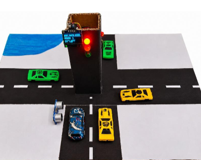
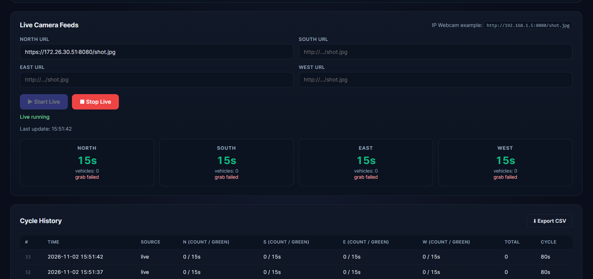
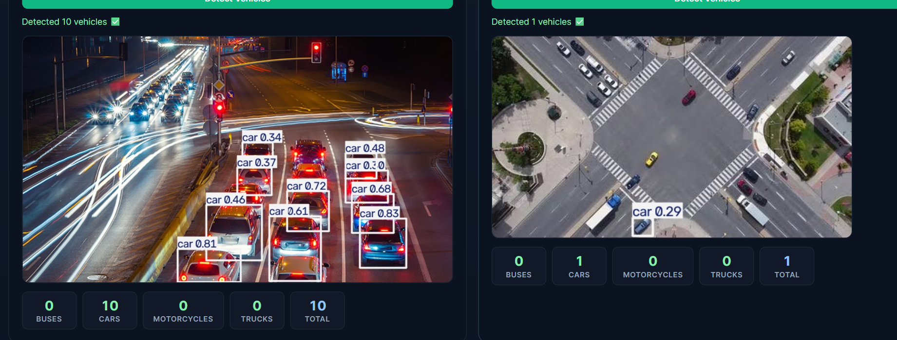

# 🚦 SmartChauraha – AI-Based Smart Traffic Signal Management System


[](https://www.linkedin.com/in/hiten-vashistha/)

## 🚀 [**Try the Live Demo →**](https://smart-traffic-api-y9k5.onrender.com/)

> ⏳ *Hosted on Render's free tier — first load may take **30–60 seconds** to wake up. Subsequent loads are instant.*

📹 **Video demo:** [Watch on YouTube](https://youtu.be/IWPCFcEgR90)

---

## 📌 Table of Contents
- [Live Demo](#-live-demo)
- [Overview](#-overview)
- [Problem Statement](#-problem-statement)
- [How It Works](#️-how-it-works)
- [Tech Stack](#-tech-stack)
- [Hardware Components](#-hardware-components)
- [Adaptive Signal Timing](#-adaptive-signal-timing-model)
- [Signal State Sequence](#-signal-state-sequence)
- [Project Gallery](#-project-gallery)
- [Roadmap & Status](#️-roadmap--current-status)
- [Future Scope](#-future-scope)
- [Author](#-author)

---

## 🚀 Live Demo

**👉 [https://smart-traffic-api-y9k5.onrender.com/](https://smart-traffic-api-y9k5.onrender.com/)**

The live dashboard shows:
- **Live signal status** for all four lanes (green / yellow / red + countdown)
- **Per-lane vehicle counts** from YOLOv8n detection
- **Timing control panel** (min green, max green, cycle length)
- **Signal state exposed** at `GET /api/signal` for the ESP32 hardware to poll

### ⚠️ Render Free Tier Notice
The server **sleeps after 15 minutes of inactivity**.
- **First visit** → allow **30–60 seconds** for cold start
- **After it wakes** → dashboard updates every 2 seconds in real time
- If it times out, **just refresh once**

---

## 🔍 Overview

**SmartChauraha** is a smart traffic signal prototype that replaces fixed-timing signals with **AI-driven adaptive timing**. It uses a **phone camera** (IP Webcam app) to stream live footage, **YOLOv8n** to detect and count vehicles per lane, and a **Flask backend** to compute green times and push signal states to both a live web dashboard and an **ESP32** controlling physical LEDs.

The project is deliberately built with a **minimal, failure-resistant stack** — no Node.js, no React build step, no MQTT broker — so the demo runs reliably on a single laptop and deploys in one click.

---

## ❗ Problem Statement

- Fixed-time signals cannot respond to changing traffic — vehicles wait at red lights even when other roads are empty.
- Queues grow unevenly, and emergency vehicles get stuck.
- Advanced adaptive systems need costly sensors and infrastructure that most Indian cities cannot afford.

### 🎯 Objectives
- Build a **low-cost AI-based** traffic signal controller using a phone camera and open-source tools.
- Detect and count vehicles per lane with **YOLOv8n** in real time.
- Compute **density-proportional green timings** and display them on a live dashboard.
- Drive **ESP32 / ESP8266** hardware over a simple HTTP link.
- Keep the stack **demo-safe** for a college project.

---

## ⚙️ How It Works

```
Phone Camera (IP Webcam, MJPEG over HTTP)
          │
          ▼
   Flask Backend (Python)
          │
   ┌──────┴──────┐
   ▼             ▼
OpenCV +      Timing Algorithm
YOLOv8n       (counts → green secs)
   │             │
   ▼             ▼
Per-lane      Web Dashboard (plain HTML/JS)
vehicle           +
counts        ESP32 (HTTP polling)
                  │
                  ▼
              LEDs (Red / Yellow / Green)
```

1. **Capture** – Flask pulls frames from the phone's IP Webcam stream.
2. **Detect** – YOLOv8n counts cars, buses, trucks and motorcycles per lane.
3. **Decide** – The timing algorithm assigns green time proportional to density.
4. **Actuate** – The dashboard updates every 2 s; the ESP32 polls `GET /api/signal` every 2 s to light the correct LED.
5. **Log** – Every cycle is stored in **SQLite** (upgradeable to MySQL via SQLAlchemy).

---

## 🧰 Tech Stack

| Layer | Technology | Why |
|-------|------------|-----|
| **AI / CV** | **YOLOv8n** (Ultralytics) + **OpenCV** | One-line model load; COCO classes cover car, truck, bus, motorcycle |
| **Backend** | **Flask** (Python 3.11) | Simplest mental model; no async |
| **Frontend** | **Plain HTML + CSS + JS** served by Flask | No Node.js, no build step |
| **Live Updates** | **Polling** every 2 s | One line of JS; no WebSocket complexity |
| **Database** | **SQLite** (→ MySQL via SQLAlchemy) | Zero install; upgrade path for report |
| **IoT Link** | **ESP32 HTTP polling** | No MQTT broker needed |
| **Camera** | **Phone IP Webcam app** | Free MJPEG stream |
| **Hosting** | **Render** (free tier) | One-click deploy from GitHub |

---

## 🛠 Hardware Components

| Component | Purpose |
|-----------|---------|
| **ESP32** (or ESP8266) | Polls `GET /api/signal`, drives LEDs |
| **Traffic Signal LEDs** | Red / yellow / green per lane |
| **Resistors + Breadboard** | Current limiting and prototyping |
| **5V Power Supply** | Powers the LED setup |
| **Phone Camera** | Live lane footage via IP Webcam (the "sensor") |

---

## 📐 Adaptive Signal Timing Model

Instead of equal fixed durations, busier lanes get more green time:

```
gᵢ = gₘᵢₙ + (dᵢ / Σdᵢ) × (C − n × gₘᵢₙ),   subject to gₘᵢₙ ≤ gᵢ ≤ gₘₐₓ
```

- `dᵢ` = detected vehicle density for lane *i*
- `gₘᵢₙ` / `gₘₐₓ` = minimum / maximum green time
- `C` = cycle length
- `n` = number of lanes

Implemented in `backend/logic/timing.py` with unit tests.

---

## 🔄 Signal State Sequence

| Phase | Road A | Road B | Road C / D | Action |
|-------|--------|--------|------------|--------|
| 1 | 🟢 Green | 🔴 Red | 🔴 Red | Road A proceeds |
| 2 | 🟡 Yellow | 🔴 Red | 🔴 Red | Transition interval |
| 3 | 🔴 Red | 🟢 Green | 🔴 Red | Road B proceeds |
| 4 | 🔴 Red | 🔴 Red | 🟢 Green in turn | Cycle repeats |

All conflicting roads are held at **red** during each phase.

---

## 📸 Project Gallery

### 🔧 Hardware Prototype



> Cardboard intersection model with four LED signal heads, dual ESP8266 controllers, OLED status display, and real wiring.

### 💻 Live Dashboard

| Live Signal Status | Timing Control |
|:---:|:---:|
|  |  |
| **Live signal state for all four lanes** | **Timing configuration + vehicle counts** |

---

## 🗺 Roadmap & Current Status

| Phase | Objective | Status |
|-------|-----------|--------|
| 1 | Flask app + homepage | ✅ Done |
| 2 | Image / video / IP Webcam frame capture | ✅ Done |
| 3 | YOLOv8n per-lane detection | ✅ Done |
| 4 | Timing algorithm + unit tests | ✅ Done |
| 5 | 4-lane timing displayed on page | ✅ Done |
| 6 | Auto-loop every 2 s | ✅ Done |
| 7 | SQLite logging + history page | 🔄 In progress |
| 8 | ESP32 firmware polling `/api/signal` | 🔄 In progress |
| 9 | Deploy on Render + report material | ✅ Done |

---

## 🚀 Future Scope

- 🧠 **Reinforcement Learning** for signal timing (state = density + queue; action = phase + duration; reward = −waiting time)
- 🚑 **Emergency vehicle priority** (ambulance / fire truck detection)
- 📊 **MySQL + analytics dashboard** for historical traffic patterns
- 🌐 **Multi-intersection coordination** (green wave)
- ☀️ **Solar + battery backup** for the hardware node
- 📡 **LoRa backup communication** for unreliable Wi-Fi

---

## 👨‍💻 Author

**Hiten Vashistha**
- 🎓 MCA Student, Chandigarh University
- 🔗 GitHub: [@hitenvashistha-cloud](https://github.com/hitenvashistha-cloud)
- 🌐 Live Demo: [smart-traffic-api-y9k5.onrender.com](https://smart-traffic-api-y9k5.onrender.com/)
- 💼 LinkedIn: [linkedin.com/in/hiten-vashistha](https://www.linkedin.com/in/hiten-vashistha-307514204/)
---

## 📜 License

MIT License — see [LICENSE](LICENSE) for details.

---

⭐ **If you found this project helpful, please give it a star!**
